<div align="center">

# UnifiedRGB

**All your RGB. One app. Zero bloat.**

Keyboards, mice, a headset, the motherboard, GPU, DRAM, fans and the pump
LCD, driven directly from one tray app, with fan curves and temperatures
alongside. No vendor launchers, no accounts, no telemetry.

### [unifiedrgb.com](https://unifiedrgb.com)

[](https://github.com/fikal/UnifiedRGB/releases/latest)
[](https://github.com/fikal/UnifiedRGB/actions)
[](LICENSE)

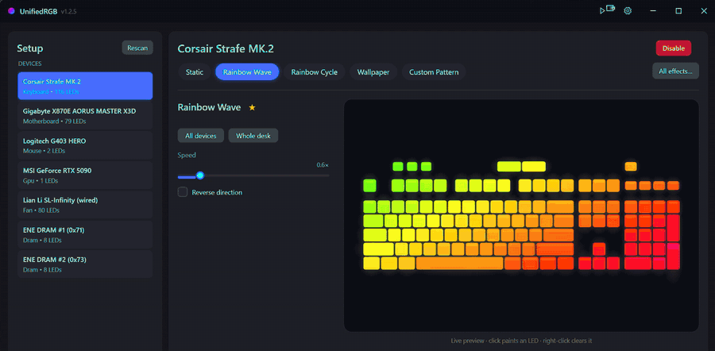

</div>

## Download

Grab `UnifiedRGB-vX.Y.Z.exe` from the
[latest release](https://github.com/fikal/UnifiedRGB/releases/latest). It is
one self-contained exe with nothing else to install, not even .NET.

It checks this repo for a new release at startup and updates itself in one
click, after checking the download against the published SHA-256. You can turn
the check off in Settings.

Turning on **Start with Windows** copies the exe to
`C:\Program Files\UnifiedRGB` and starts that copy at logon, elevated and
without a prompt. It runs from there rather than from Downloads because
any program you run can replace a file in Downloads, and that file would run
as administrator at your next logon.

> The binary is unsigned, so SmartScreen warns on first run
> (**More info → Run anyway**). Each release publishes its SHA-256, and you can
> build it yourself.

## The tour

### 59 effects, on one device, one zone, or the whole desk

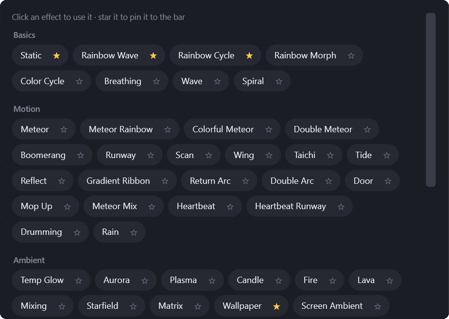

- **Motion and ambient:** rainbows, meteors, plasma, aurora, candle flicker,
  rain, Matrix, and a circadian Time Warmth that runs cool by day and warm at
  night.
- **Audio:** bars and pulses driven by WASAPI loopback, so they move the
  moment the sound does.
- **Keyboards:** Key Ripple and Key Fade light up from the keys you press.
- **Your screen:** whole-screen ambient, Wallpaper Engine capture, and Razer
  Chroma games, with no Razer software installed.
- **Palette effects** that cycle through colors you chose.
- **Temp Glow,** which runs green to red with the hotter of the CPU and GPU
  and pulses faster as the machine works harder.

Apply an effect to one device, to one fan ring, or to everything at once.

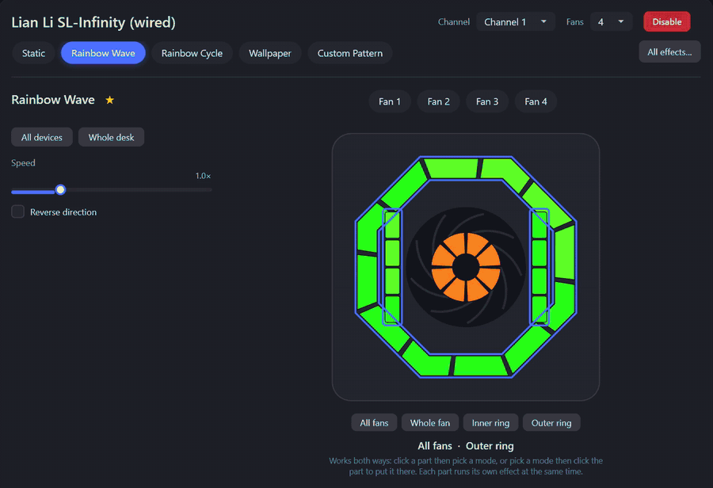

Lian Li fans are zone-addressable: pick a fan, its inner or outer ring, or the
whole array, and each part runs its own effect at the same time.

### Colors you actually chose

A real wheel with brightness, hex and RGB entry and your own swatches, and a
**Palette Library** with curated presets and your saved sets. Paste a
[coolors.co](https://coolors.co) link or a list of hex codes to import one.

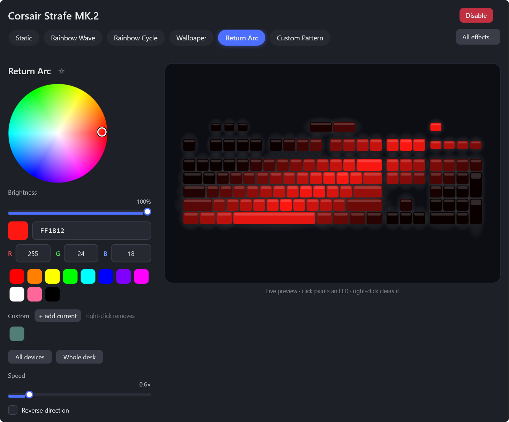

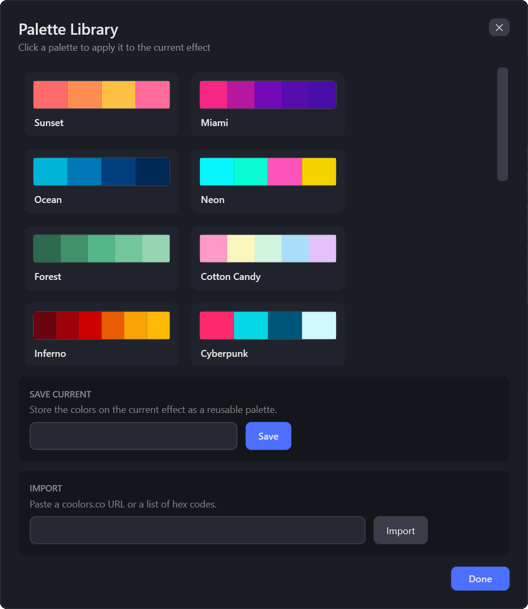

Every vendor puts different LEDs behind different plastic, so the same color
comes out warm on one device and cold on the next. **Color calibration**
trims each device, or each zone of one, against white, mid grey and the
primaries until they match each other.

### One effect across your whole desk

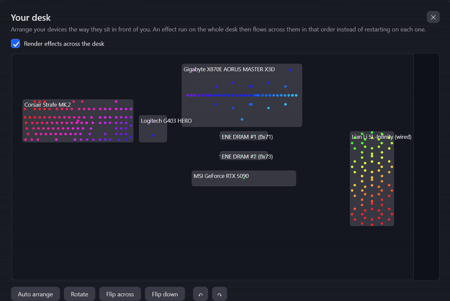

Lay your devices out the way they sit in front of you, then run an effect on
the desk instead of on each device. A wave rolls off the keyboard, across the
mouse and up the case fans as one image, in the order they really are, rather
than starting over on every device.

The same screen is where you say where a device's LEDs physically are: a strip
taped along a GPU is a line, a fan is a ring, a matrix usually snakes back on
every other row. Say it once and every effect renders correctly on it.

### A dashboard on your pump LCD

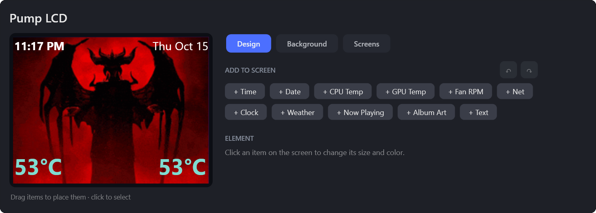

A drag-and-drop designer for Thermalright's 240×320 pump display: CPU and GPU
temperatures, clocks, the date, fan RPM, network throughput, weather, what is
playing (with album art), and your own text, over an image or GIF background.
Build several screens and sequence them.

A profile remembers its pump screen, so one profile switch from a hotkey, an
app rule or a schedule changes the lights and the pump together. If the
panel's firmware locks up and the screen goes dark, the app notices and
restarts the panel itself.

### Shows

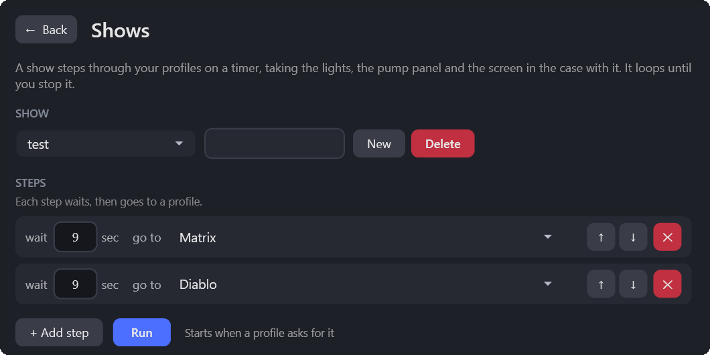

A show steps through your profiles on a timer and loops until you stop it. It
takes the lights, the pump screen and Wallpaper Engine along with it, so it
works as a scene for a stream or a LAN party. You can pause a show and pick it
up at the same step.

### Fan curves and temperatures

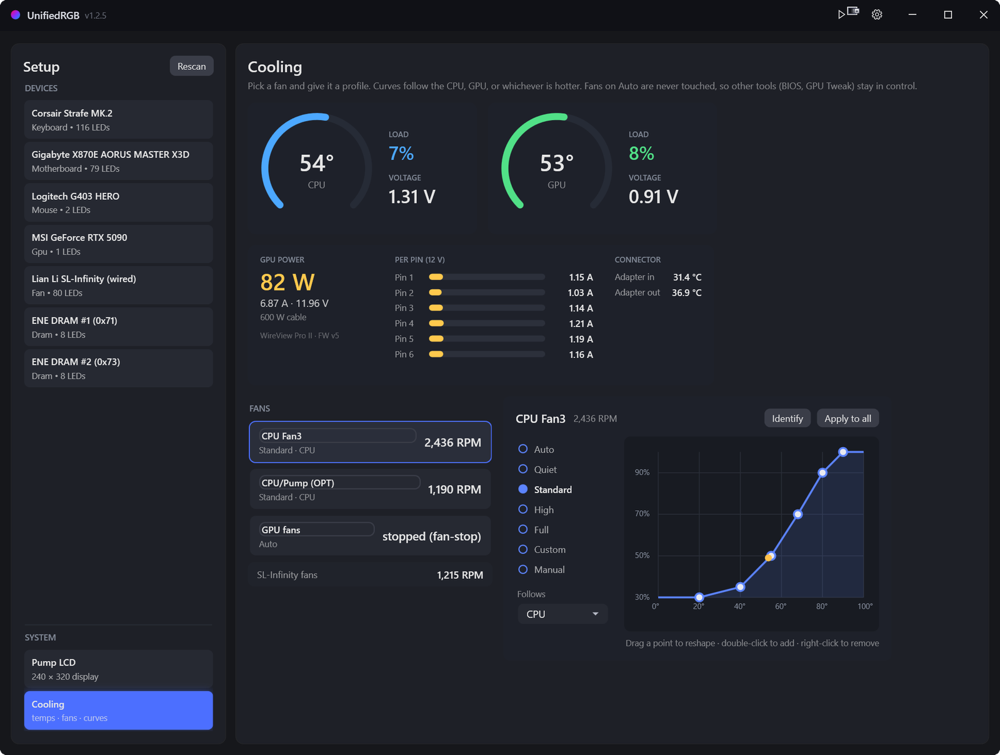

Curves follow the CPU, the GPU, or whichever is hotter, with live gauges,
per-fan profiles and a drag-to-edit curve editor. Fans you leave on Auto are
never touched, so BIOS profiles and GPU tools stay in charge of them.

If the CPU reaches 96 °C or the GPU 90 °C, a failsafe gives the board's fans
back to the BIOS and runs wireless fans at full speed.

With a Thermal Grizzly **WireView Pro II** on the GPU's power connector, the
Cooling pane also shows board power and the current on each pin of the
connector.

### Lights that react, and that know when to go dark

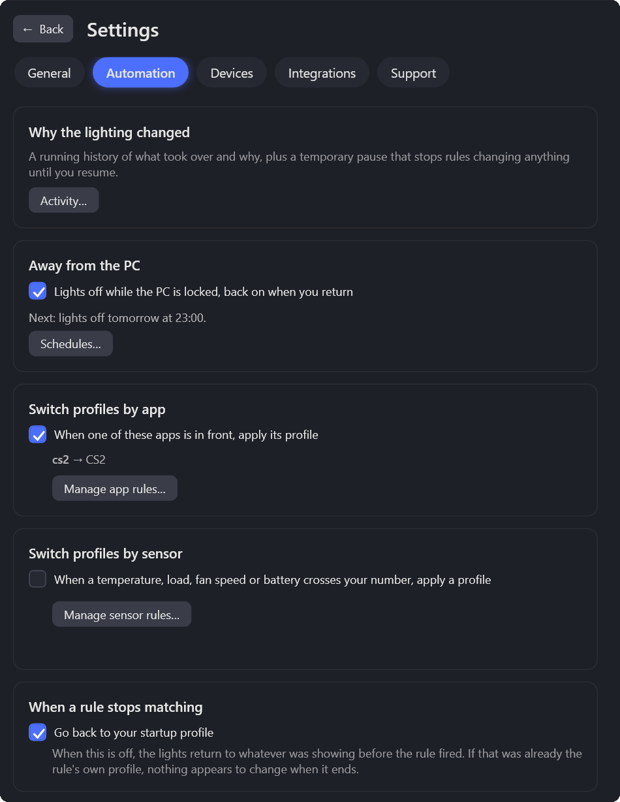

- **App rules** switch profile when a program comes to the front.
- **Sensor rules** fire on temperature, load, fan speed or a wireless
  device's battery. Cross the number and a profile applies; drop back and your
  lighting returns.
- **Schedules** turn the lights off for a stretch of the night, or run a
  profile between two times on the days you pick. A lights-off window can
  wait until the PC has been idle, so it never goes dark while you're still
  at the desk.
- **Lock or sleep the PC** and the lights go off. They come back when you
  return. This is on by default.
- **Counter-Strike 2** drives the lights from the game's own state: your
  health is a bar that runs green to red, every hit lands as a red spike, a
  kill flashes white, a flashbang whites out the whole rig, and a planted bomb
  pulses red faster as the fuse runs down. It uses Valve's Game State
  Integration, so nothing is injected and nothing is read from memory.

When the lighting changes and you didn't change it, **Activity** says which
rule, schedule, sensor or SDK client did it. **Pause** stops rules and
schedules from changing anything until you resume.

### It works with what you already use

- **OpenRGB SDK server.** Anything written for OpenRGB can drive your
  lighting unchanged: Home Assistant, game mods, phone remotes, Stream Deck
  plugins. A client that takes a device over gets it, and your lighting comes
  back the moment it disconnects. The server is off until you turn it on, and
  it listens on this PC only unless you allow the network, because the
  protocol has no password.
- **Razer Chroma.** Wallpaper Engine and Chroma games light your devices,
  with no Razer software installed. Games that use Chroma's REST API work out
  of the box. Wallpaper Engine and games that load Razer's DLL need a small
  interop file, which Settings installs with one click. If you have Razer
  Synapse, your Razer gear keeps working: its file is backed up and passed
  through to.
- **Wallpaper Engine profiles.** A UnifiedRGB profile can switch Wallpaper
  Engine to one of its own profiles when it applies.
- **The OpenRGB bridge.** For hardware without a native driver here, turn the
  bridge on and UnifiedRGB downloads a pinned [OpenRGB](https://openrgb.org)
  release, checks its SHA-256, and runs it in the background. Hardware we
  drive natively is never handed to it.

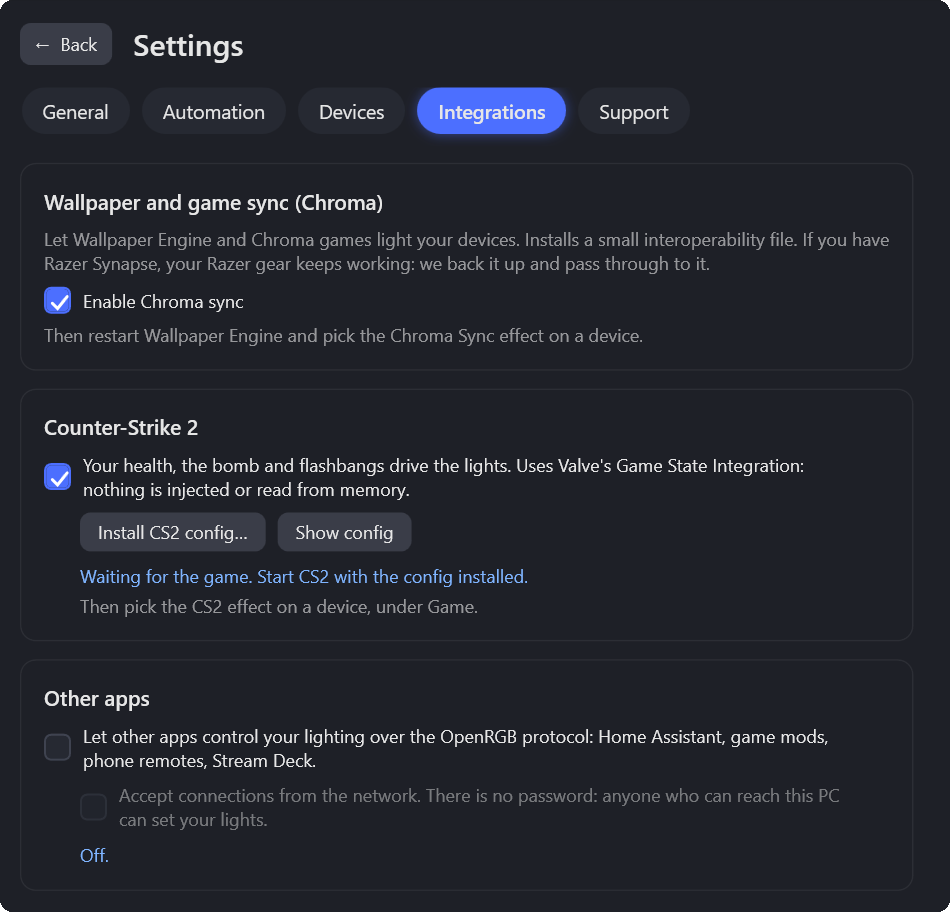

### It hands your hardware back, and keeps hold of it while it runs

When UnifiedRGB closes, a device doesn't have to be left on whatever frame
happened to be last. For devices that support it, you choose: leave it on a
color, turn it off, or let it go back to its own saved profile.

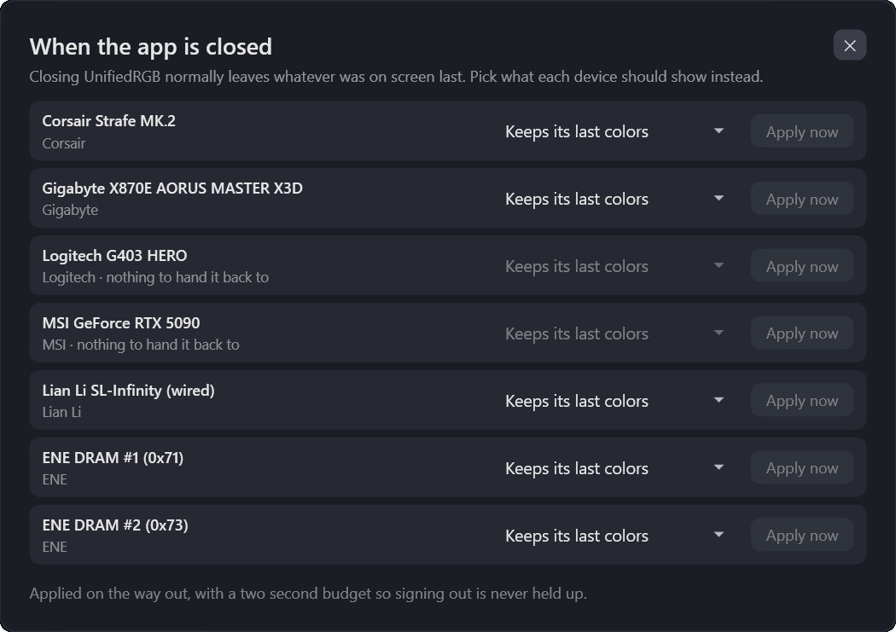

While the app runs, a device that drops off after sleep or gets unplugged and
plugged back in is picked up again by itself. If the app can see a device but
can't drive it, **Settings → Devices** says why and what fixes it.

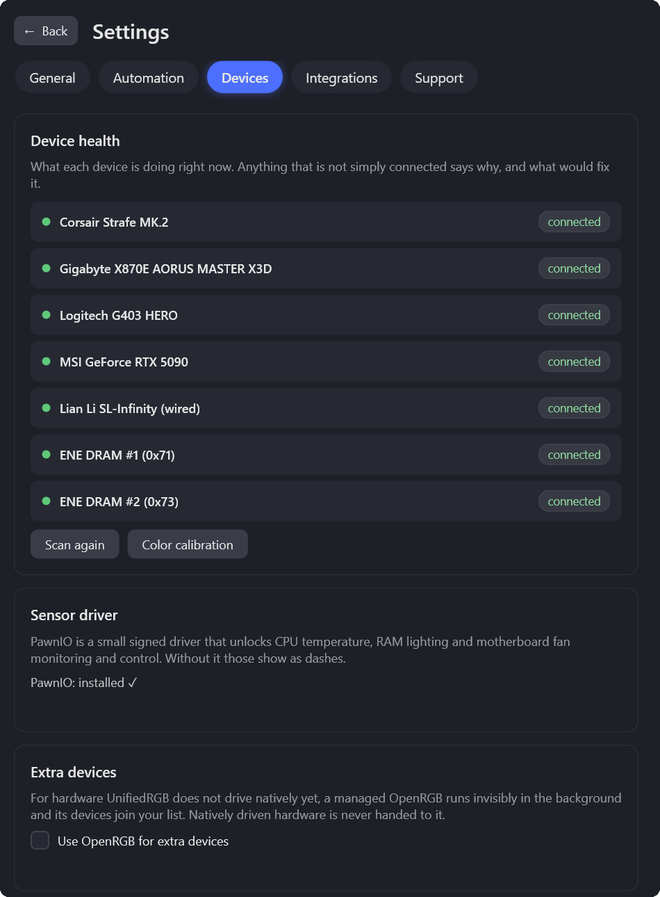

### Everything else

- Profiles with global hotkeys that work in games: `Ctrl+Alt+1…9` applies a
  profile and `Ctrl+Alt+↑/↓` nudges the master brightness.
- Per-device disable, and undo and redo in the LCD designer.
- **Backup and restore.** Profiles, pump screens and their images, shows,
  palettes, the desk layout and rules go into one `.urgb` file that you can
  keep or move to another PC. Opening one shows exactly what would change
  before anything is written.
- Lian Li wireless fans play effects smoothly. Streaming frames over their
  radio tops out around 8 fps, so the app uploads a loop of the effect and
  the fans play it themselves. (Effects that follow live input, such as audio
  or temperature, still stream.)
- A first-run wizard, and it lives in the tray.

### Light on resources

Measured on the author's PC, in the tray, with an effect running across
seven devices on the desk and an animated GIF on the pump screen: about 14% of
one core on average, which is under half a percent of a 32-thread CPU, and
34 MB of private memory. The window costs more while it is open. Drivers skip
a frame identical to the last one they wrote, and the engine skips again per
device, so a settled effect costs almost nothing until it changes.

## Supported hardware

Native drivers, talking to the hardware directly.

| Device | What it does | How |
|---|---|---|
| Corsair Strafe MK.2 | Per-key lighting | HID |
| SteelSeries Apex Pro TKL Gen 3, Apex Pro TKL (2023) | Per-key lighting | HID |
| Logitech G403 HERO | Lighting | HID++ 2.0 |
| Razer Basilisk V3 Pro, V3 Pro 35K | Lighting, battery (DPI stages and polling rate from the CLI) | HID, no Synapse |
| Razer Kraken V3 X headset | Lighting | HID |
| SayoDevice E1 | Lighting | HID |
| Gigabyte RGB Fusion 2 boards (IT5711, IT8297) and their ARGB headers | Lighting | HID |
| MSI GeForce RTX cards (Gaming Trio and similar) | Lighting | I²C via NvAPI |
| ENE DRAM (G.Skill and others) | Lighting | SMBus via PawnIO |
| Lian Li SL-INF wireless fans | Per-ring lighting | WinUSB and RF |
| Lian Li SL-Infinity wired hub | Per-fan lighting | HID |
| Thermalright pump LCD (Frozen Warframe, 240×320) | Dashboards | HID |
| AMD Ryzen CPUs | Temperature | PawnIO |
| NVIDIA GPUs | Temperature, fan control | NvAPI |
| Motherboard fan headers | Speeds, fan control | Super I/O via PawnIO |
| Thermal Grizzly WireView Pro II | GPU power, per-pin current | USB serial |
| Everything else OpenRGB supports | Lighting | The opt-in [OpenRGB](https://openrgb.org) bridge |

Lian Li wireless fans need pairing once in L-Connect 3, and L-Connect has to be
closed while UnifiedRGB runs, because both want the receiver.

Missing your hardware?
[Open a device request](https://github.com/fikal/UnifiedRGB/issues/new/choose).
Protocol notes and USB captures are the fastest route to a driver.

## ⚠️ Read before running

- The app **requires administrator.** CPU temperature, DRAM lighting and
  motherboard fans need [PawnIO](https://pawnio.eu/), a signed,
  module-constrained kernel driver. The app offers to install it with one
  click, downloading PawnIO's official installer; without it those features
  show as dashes. It is real kernel access, so understand it before you
  install it.
- DRAM lighting talks **raw SMBus.** The implementation follows OpenRGB's
  proven ENE detection (remap-then-probe at known-safe addresses), with one
  addition: whatever answers at the shared address 0x77 must identify as an
  ENE controller, by reads only, before the remap writes go to it. As with
  every tool in this category, writing to the wrong SMBus device can
  permanently damage hardware; nothing here writes to an SMBus address that
  has not identified as ENE. (Detection elsewhere may send a protocol's own
  read-only identification query, such as Logitech's HID++ feature lookup,
  but never a write to an unidentified device.)
- Protocols were reverse-engineered for interoperability (USB captures and
  behavioral analysis), and several drivers began as ports of
  [OpenRGB](https://codeberg.org/OpenRGB/OpenRGB)'s GPLv2 device code, which is
  one of the reasons this project is GPLv2. All product names belong to their
  owners; this project is affiliated with none of them.

## Privacy

There is no telemetry. This is everything the app sends over the network,
and when:

| When | Where | Why |
|---|---|---|
| Startup (turn it off in Settings) | `api.github.com` | Is there a newer release? |
| You click **Update** | `github.com` | Downloads the release, checked against its SHA-256 |
| You click **Install PawnIO** | `github.com/namazso/PawnIO.Setup` | Downloads PawnIO's official installer |
| You turn on the OpenRGB bridge | `codeberg.org` | Downloads the pinned OpenRGB release, checked against its SHA-256 (again only if an update pins a newer one) |
| Every 15 minutes while a pump screen has a weather widget | `wttr.in` | The weather; wttr.in places you by your IP address |

What it listens on, all on this PC only unless noted: Razer Chroma's REST port
`localhost:54235` and its interop pipe, which refuses other machines; the
Counter-Strike 2 listener on `localhost`, only while CS2 lighting is on; and
the OpenRGB SDK server, only while it is on, and on the network only if you
allow that.

**Report a problem** writes a diagnostic file to your Desktop and opens a
prefilled GitHub issue for you to attach it to; nothing is uploaded unless you
post it. (The source also supports a private update feed selected by
build-time properties. Official builds don't use one; it exists so forks can
run their own.)

## Building

Requirements: Windows 10 or 11 (x64) and the
[.NET 10 SDK](https://dotnet.microsoft.com).

```
dotnet build src/UnifiedRgb.App -c Release
dotnet run --project src/UnifiedRgb.Tests        # the harness: engine, protocols, drivers over a fake HID transport
```

The CLI harness (`dotnet run --project src/UnifiedRgb.Cli`) lists detected
devices and can set colors headlessly, which is useful when bringing up a new
driver. Don't run it while the app is running; both would drive the same
devices.

Optional: the Razer Chroma interop shim (`native/chroma-shim`) builds with
`build.bat` (needs the Visual Studio C++ toolset) in both bitnesses:
`RzChromaSDK64.dll` for Wallpaper Engine and 64-bit games, `RzChromaSDK.dll`
for 32-bit games. Release builds bundle both inside the single-file exe; a dev
checkout without them hides that option in Settings.

## Contributing

See [CONTRIBUTING.md](CONTRIBUTING.md). Device support PRs are especially
welcome. [ADDING_A_DEVICE.md](ADDING_A_DEVICE.md) is the contract a driver has
to meet, and shows how to test one against the harness's fake HID transport
without owning the hardware. Found a bug? The in-app **Report a problem**
button collects everything we need.

## License

[GPLv2](LICENSE). It is required by the OpenRGB-derived drivers, and chosen
gladly: it keeps reverse-engineered protocol work open for everyone.
